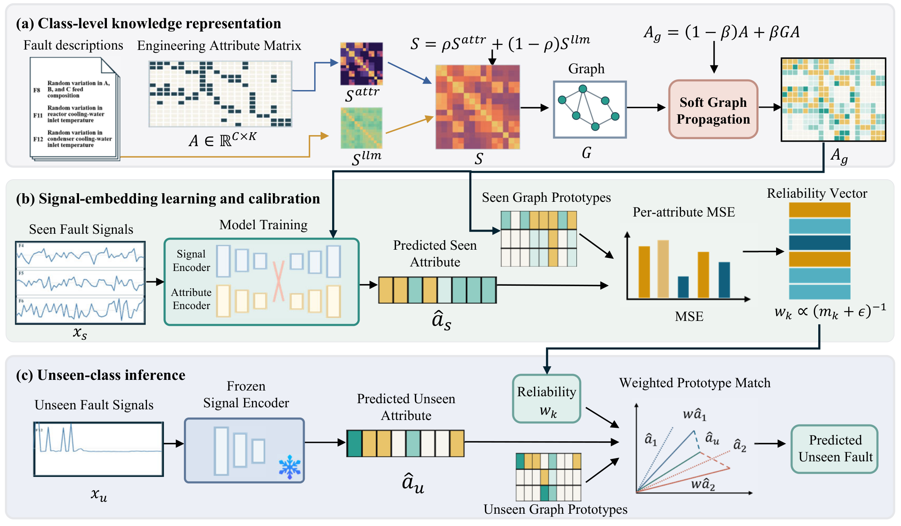
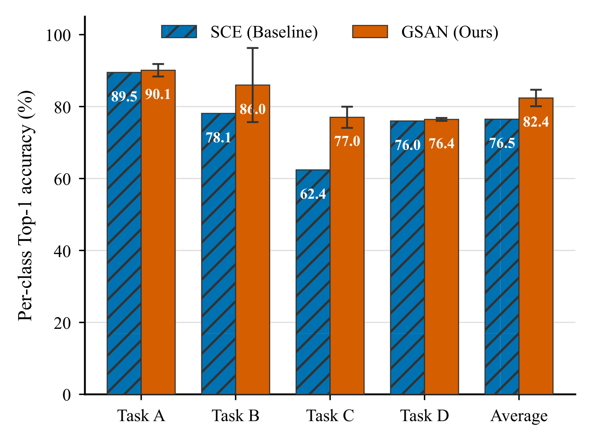
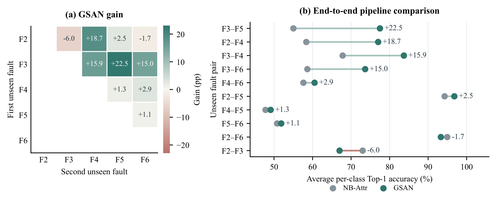

<div align="center">
  <h1>GSAN</h1>
  <h3>Graph Semantic Attribute Network</h3>
  <p><strong>Advanced Engineering Informatics · 77 (2027), 105423</strong></p>
  <p><a href="https://doi.org/10.1016/j.aei.2026.105423">Paper</a> · <a href="https://www.sciencedirect.com/science/article/pii/S1474034626011158">ScienceDirect</a></p>
  <p><strong>English</strong> | <a href="README.zh-CN.md">简体中文</a></p>
  <p><a href="#framework">Framework</a> · <a href="#results">Results</a> · <a href="#quick-start">Quick start</a> · <a href="#documentation">Documentation</a> · <a href="#citation">Citation</a></p>
</div>

**[Large Language Model-Guided Graph Semantic Attribute Propagation for Zero-Shot Industrial Fault Diagnosis](https://doi.org/10.1016/j.aei.2026.105423)**  
Fengli Shen · Yuxi Gan · Lei Zhou · Xiao Chen

GSAN supports zero-shot fault diagnosis through two modules. **Graph semantic attribute propagation** refines interpretable engineering attributes using language-derived fault relations. **Signal-grounded reliability calibration** uses attribute prediction errors on seen faults to weight unseen-fault diagnosis.

<a id="framework"></a>
## Framework

<p align="center">
  
</p>

- **(a) Class-level knowledge representation.** Combine language and engineering-attribute similarities to build the fault graph and refine attribute prototypes through propagation.
- **(b) Signal-embedding learning and calibration.** Train on seen-fault signals and estimate attribute reliability using held-out seen-class samples.
- **(c) Unseen-class inference.** Predict attributes from unseen signals and classify them by reliability-weighted prototype matching.

The framework is shown in **Figure 2** of the paper.

Descriptions and embeddings are prepared offline. Training and inference can use the supplied fixed inputs without an LLM service.

<a id="results"></a>
## Main results

| Benchmark | Evaluation | Accuracy (%) | Paper reference |
|---|---|---:|---|
| **TEP** | Four zero-shot tasks | **82.39 ± 2.30** | Tables 7–8; Figure 5 |
| **TPTS** | Ten zero-shot splits with two unseen classes | **73.06 ± 1.25** | Table 14; Figure 8 |

Results are reported as the mean ± sample standard deviation of five independent experiments. Within each experiment, accuracies are first averaged over the tasks or splits.

### TEP diagnosis

**Paper: Table 7 and Figure 5.**

<p align="center">
  
</p>

GSAN improves the average accuracy from 76.5% for SCE to 82.4%. The SCE values come from the paper by Hu et al. [[1]](#ref-sce). The GSAN bars and error bars show the mean and standard deviation of five independent experiments. In the paper's additional baseline comparisons, **Adapted SCE** refers to our modified version of the authors' [public SCE code](https://github.com/htz-ecust/Semantic-consistent-Embedding).

### Component ablation

**Paper: Table 8.**

| Variant | Graph | Reliability | Accuracy (%) |
|---|:---:|:---:|---:|
| GSAN-base | — | — | 78.59 ± 3.55 |
| GSAN-G | ✓ | — | 79.05 ± 2.61 |
| GSAN-R | — | ✓ | 80.62 ± 3.02 |
| **GSAN** | ✓ | ✓ | **82.39 ± 2.30** |

Both modules improve GSAN-base individually, and their combination achieves the highest accuracy in this comparison.

### Cross-system validation on TPTS

**Paper: Figure 8.**

<p align="center">
  
</p>

Across ten zero-shot splits, the GSAN-based pipeline improves the signal-only NB-Attr reference from **65.84% to 73.06%**, with gains on eight splits. This is an end-to-end pipeline comparison. The primary TPTS result uses uniform attribute matching; reliability weighting is evaluated separately.

<a id="quick-start"></a>
## Quick start

### 1. Install

Use **Python 3.11**. The checked environment uses PyTorch 2.5.1; pretrained inference supports CPU.

```sh
git clone https://github.com/qiang92/Graph-Semantic-Attribute-Network.git
cd Graph-Semantic-Attribute-Network
python -m pip install -r requirements.txt
```

### 2. Prepare measurements

Download the [TEP records](https://github.com/YKatser/CPDE/tree/master/TEP_data) and [TPTS CSV](https://www.kaggle.com/datasets/esathyaprakash/electrical-fault-detection-and-classification), then arrange them as follows:

```text
data/
├── TEP_data/
│   ├── d01.dat
│   ├── ...
│   └── d15.dat
└── classData.csv
```

Use only TEP `d01.dat`–`d15.dat` (480 samples × 52 variables each) in `data/TEP_data/`. These records contain observations collected after fault injection. The `_te.dat` files include 160 normal-operation samples before fault injection, so the entire file cannot be assigned the corresponding fault label ([TEP data description](https://ieee-dataport.org/documents/tennessee-eastman-process-data-set)).

The repository already includes the attribute matrices, language vectors and pretrained models, so after downloading the measurements you can run the commands below directly. See [data preparation](data/README.md) for file and preprocessing details.

### 3. Evaluate pretrained models

```sh
python evaluate.py --data data/TEP_data --output outputs/tep_pretrained
```

This evaluates all **20 TEP models** and reports **82.39% ± 2.30%** in `outputs/tep_pretrained/results.json`.

<details>
<summary>TPTS pretrained evaluation and single-record inference</summary>

```sh
python evaluate_tpts.py --data data/classData.csv --output outputs/tpts_pretrained
python gsan_inference.py --model models/tep/seed904/task_1 --input data/TEP_data/d01.dat --record-lengths 480 --output predictions.npz
```

To reproduce the paper's five-experiment TPTS average of **73.06%**, run `tpts_main` below.

</details>

### 4. Train

```sh
# TEP: four tasks, five runs
python run_experiment.py tep_main --output outputs/tep_main

# TPTS: ten fault pairs, five runs
python run_experiment.py tpts_main --output outputs/tpts_main
```

To run one complete TEP repetition, add `--seeds 904`. New runs save metrics, predictions and selected models. Scientific settings and model-selection rules are documented in [Reproducing the paper](docs/REPRODUCING.md).

<a id="documentation"></a>
## Documentation

| Purpose | Entry |
|---|---|
| Paper experiment settings and protocols | [Reproducing the paper](docs/REPRODUCING.md) |
| Training, inference and analysis commands | [Command reference](docs/USAGE.md) |
| Ablations, graph modules, language and parameter sensitivity | [36 experiment configurations](configs/experiments.json) |

<a id="citation"></a>
## Citation

Fengli Shen, Yuxi Gan, Lei Zhou, and Xiao Chen. Large language model-guided graph semantic attribute propagation for zero-shot industrial fault diagnosis. *Advanced Engineering Informatics*, **77** (2027), 105423. https://doi.org/10.1016/j.aei.2026.105423.

```bibtex
@article{shen2027gsan,
  title   = {Large language model-guided graph semantic attribute propagation for zero-shot industrial fault diagnosis},
  author  = {Shen, Fengli and Gan, Yuxi and Zhou, Lei and Chen, Xiao},
  journal = {Advanced Engineering Informatics},
  volume  = {77},
  pages   = {105423},
  year    = {2027},
  doi     = {10.1016/j.aei.2026.105423},
  url     = {https://doi.org/10.1016/j.aei.2026.105423}
}
```

## License and acknowledgments

GSAN code is provided under the [MIT license](LICENSE). The SCE-derived components build on [Semantic-consistent Embedding](https://github.com/htz-ecust/Semantic-consistent-Embedding); its original license and attribution are retained in [third-party notices](THIRD_PARTY_NOTICES.md).

## References

<a id="ref-sce"></a>
[1] Zhengwei Hu, Haitao Zhao, Lujian Yao, and Jingchao Peng. [Semantic-Consistent Embedding for Zero-Shot Fault Diagnosis](https://doi.org/10.1109/TII.2022.3210215). *IEEE Transactions on Industrial Informatics*, 19(5): 7022–7031, 2023.
