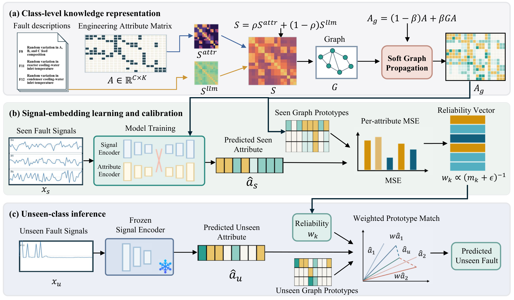
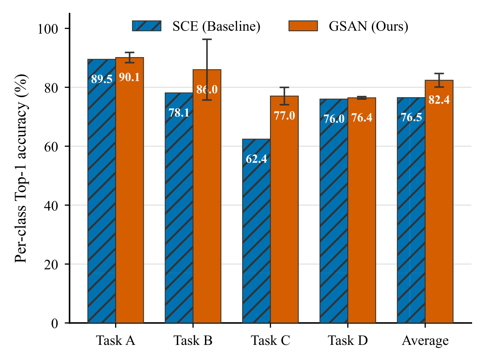
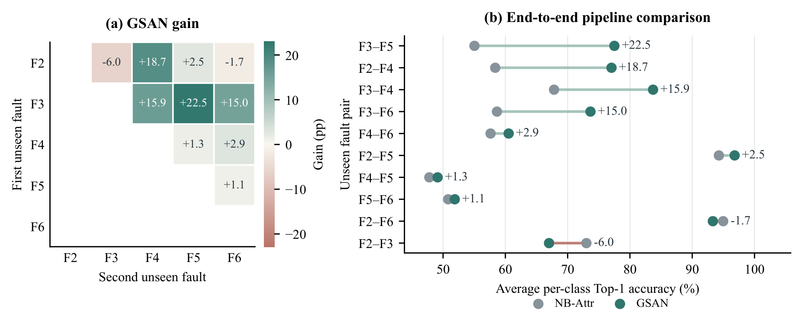

<div align="center">
  <h1>GSAN</h1>
  <h3>Graph Semantic Attribute Network</h3>
  <p><strong>Advanced Engineering Informatics · 77 (2027), 105423</strong></p>
  <p><a href="https://doi.org/10.1016/j.aei.2026.105423">论文全文</a> · <a href="https://www.sciencedirect.com/science/article/pii/S1474034626011158">ScienceDirect</a></p>
  <p><a href="README.md">English</a> | <strong>简体中文</strong></p>
  <p><a href="#framework">方法框架</a> · <a href="#results">主要结果</a> · <a href="#quick-start">快速开始</a> · <a href="#documentation">使用文档</a> · <a href="#citation">论文引用</a></p>
</div>

**[Large Language Model-Guided Graph Semantic Attribute Propagation for Zero-Shot Industrial Fault Diagnosis](https://doi.org/10.1016/j.aei.2026.105423)**  
Fengli Shen · Yuxi Gan · Lei Zhou · Xiao Chen

GSAN 通过两个模块支持零样本故障诊断。**图语义属性传播**利用语言提供的故障关系细化可解释的工程属性。**信号可靠性校准**利用已见故障上的属性预测误差，对未见故障诊断进行可靠性加权。

<a id="framework"></a>
## 方法框架

<p align="center">
  
</p>

- **(a) 类别知识表示。** 结合语言与工程属性相似度建立故障图，通过图传播细化属性原型。
- **(b) 信号嵌入学习与校准。** 使用已见故障信号训练模型，利用留出的已见类样本估计属性可靠性。
- **(c) 未见类推理。** 从未见信号预测属性，通过可靠性加权原型匹配确定故障类别。

框架图对应论文 **Figure 2**。

故障描述与语义向量在线下准备。使用仓库提供的固定输入，训练与推理无需连接大语言模型服务。

<a id="results"></a>
## 主要实验结果

| 数据集 | 评价范围 | 准确率（%） | 论文对应位置 |
|---|---|---:|---|
| **TEP** | 四个零样本诊断任务 | **82.39 ± 2.30** | Tables 7–8；Figure 5 |
| **TPTS** | 十种零样本划分，每种包含两个未见故障类别 | **73.06 ± 1.25** | Table 14；Figure 8 |

数值为五次独立实验的均值与样本标准差。每次实验先对各任务或划分的准确率取平均，再统计五次结果。

### TEP 故障诊断

**对应论文 Table 7 和 Figure 5。**

<p align="center">
  
</p>

GSAN 将平均准确率从 SCE 的 76.5% 提升至 82.4%。图中 SCE 数值来自 Hu 等人的论文 [[1]](#ref-sce)，GSAN 柱形与误差线表示五次独立实验的均值与标准差。论文其他基线对照中的 **Adapted SCE** 指我们在作者[公开 SCE 代码](https://github.com/htz-ecust/Semantic-consistent-Embedding)基础上修改得到的版本。

### 组件消融

**对应论文 Table 8。**

| 配置 | 图传播 | 可靠性加权 | 准确率（%） |
|---|:---:|:---:|---:|
| GSAN-base | — | — | 78.59 ± 3.55 |
| GSAN-G | ✓ | — | 79.05 ± 2.61 |
| GSAN-R | — | ✓ | 80.62 ± 3.02 |
| **GSAN** | ✓ | ✓ | **82.39 ± 2.30** |

两个模块单独使用时均优于 GSAN-base，联合使用在这组比较中取得最高准确率。

### TPTS 跨系统验证

**对应论文 Figure 8。**

<p align="center">
  
</p>

在十种零样本划分上，GSAN 诊断流程将仅使用信号的 NB-Attr 参考准确率从 **65.84% 提升至 73.06%**，其中八种划分获得提升。这是完整诊断流程的对照。TPTS 主结果采用不加权属性匹配，可靠性加权作为单独实验评价。

<a id="quick-start"></a>
## 快速开始

### 1. 安装

使用 **Python 3.11**。已核对环境采用 PyTorch 2.5.1，预训练模型支持 CPU 推理。

```sh
git clone https://github.com/qiang92/Graph-Semantic-Attribute-Network.git
cd Graph-Semantic-Attribute-Network
python -m pip install -r requirements.txt
```

### 2. 准备数据

下载 [TEP 信号文件](https://github.com/YKatser/CPDE/tree/master/TEP_data)与 [TPTS 数据表](https://www.kaggle.com/datasets/esathyaprakash/electrical-fault-detection-and-classification)，按下面的结构放置：

```text
data/
├── TEP_data/
│   ├── d01.dat
│   ├── ...
│   └── d15.dat
└── classData.csv
```

在 `data/TEP_data/` 中仅放置 TEP 的 `d01.dat`–`d15.dat`，每个文件包含故障注入后采集的 480 个样本和 52 个变量。`_te.dat` 文件的前 160 个样本属于故障注入前的正常运行，因此不能将整个文件的样本都标为对应故障。详见 [TEP 数据集说明](https://ieee-dataport.org/documents/tennessee-eastman-process-data-set)。

仓库已包含属性矩阵、语言向量和预训练模型，因此下载信号数据后即可直接执行下面的命令。文件格式和预处理细节见[数据准备](data/README.md)。

### 3. 评价预训练模型

```sh
python evaluate.py --data data/TEP_data --output outputs/tep_pretrained
```

该命令评价全部 **20 个 TEP 模型**，在 `outputs/tep_pretrained/results.json` 中输出 **82.39% ± 2.30%**。

<details>
<summary>TPTS 模型评价与单条记录推理</summary>

```sh
python evaluate_tpts.py --data data/classData.csv --output outputs/tpts_pretrained
python gsan_inference.py --model models/tep/seed904/task_1 --input data/TEP_data/d01.dat --record-lengths 480 --output predictions.npz
```

论文中 TPTS 五次实验的平均准确率为 **73.06%**，可通过下方的 `tpts_main` 训练命令复现。

</details>

### 4. 训练

```sh
# TEP：四个任务，五次运行
python run_experiment.py tep_main --output outputs/tep_main

# TPTS：十种故障对划分，五次运行
python run_experiment.py tpts_main --output outputs/tpts_main
```

如需只完成一次 TEP 训练，添加 `--seeds 904`。新运行会保存指标、预测和选中的模型。实验设置与模型选择方式见[论文复现说明](docs/REPRODUCING.md)。

<a id="documentation"></a>
## 使用文档

| 要查看的内容 | 入口 |
|---|---|
| 论文实验设置与评价协议 | [论文复现说明](docs/REPRODUCING.md) |
| 训练、推理及分析命令 | [完整命令说明](docs/USAGE.md) |
| 消融、图模块、语言及参数敏感性实验 | [36 个实验配置](configs/experiments.json) |

<a id="citation"></a>
## 论文引用

Fengli Shen, Yuxi Gan, Lei Zhou, and Xiao Chen. Large language model-guided graph semantic attribute propagation for zero-shot industrial fault diagnosis. *Advanced Engineering Informatics*, **77** (2027), 105423. https://doi.org/10.1016/j.aei.2026.105423.

```bibtex
@article{shen2027gsan,
  title   = {Large language model-guided graph semantic attribute propagation for zero-shot industrial fault diagnosis},
  author  = {Shen, Fengli and Gan, Yuxi and Zhou, Lei and Chen, Xiao},
  journal = {Advanced Engineering Informatics},
  volume  = {77},
  pages   = {105423},
  year    = {2027},
  doi     = {10.1016/j.aei.2026.105423},
  url     = {https://doi.org/10.1016/j.aei.2026.105423}
}
```

## 许可与致谢

GSAN 代码采用 [MIT 许可证](LICENSE)。SCE 相关组件基于 [Semantic-consistent Embedding](https://github.com/htz-ecust/Semantic-consistent-Embedding) 开发，原始许可与署名保留在[第三方声明](THIRD_PARTY_NOTICES.md)中。

## 参考文献

<a id="ref-sce"></a>
[1] Zhengwei Hu, Haitao Zhao, Lujian Yao, and Jingchao Peng. [Semantic-Consistent Embedding for Zero-Shot Fault Diagnosis](https://doi.org/10.1109/TII.2022.3210215). *IEEE Transactions on Industrial Informatics*, 19(5): 7022–7031, 2023.
